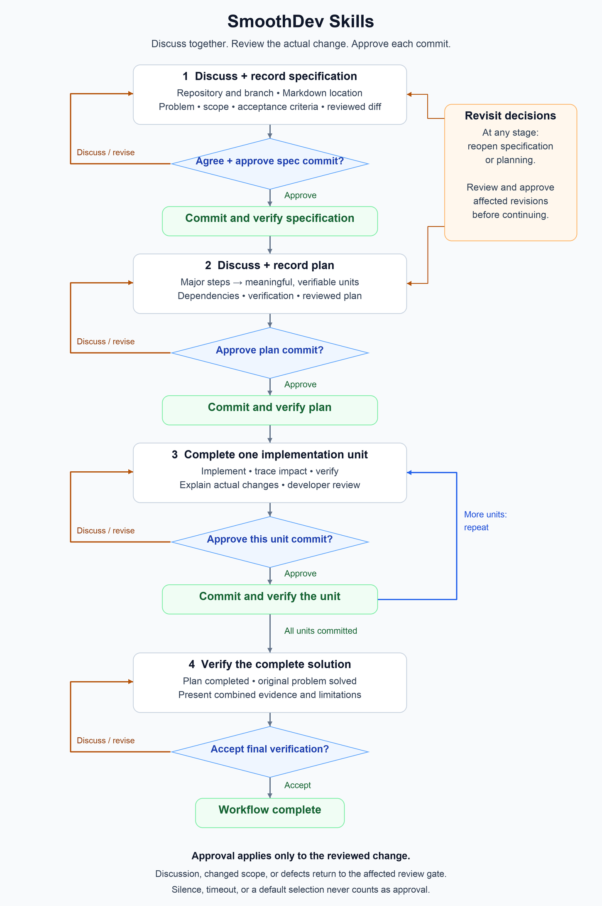

# SmoothDev Skills

A reusable AI development workflow for developers who want to discuss the
problem, understand the proposed solution, and review the consequences of every
meaningful commit.

SmoothDev Skills guides the AI to work beside you: discuss, document, implement,
explain, verify, and wait for your explicit approval before committing a reviewed
change. The complete workflow lives in
[SKILL.md](skills/smoothdev-skills/SKILL.md), using the shared
[Agent Skills format](https://agentskills.io/specification).

## How the workflow works



1. **Discuss and record the specification.** Establish the repository, checkout,
   and branch, then agree on the document's location and structure. Discuss and
   revise the problem, scope, constraints, and acceptance criteria together.
   Review the actual document and diff; explicit approval of its separate commit
   confirms the specification agreement.
2. **Discuss and record the plan.** Agree on the solution and its breakdown into
   meaningful, verifiable units. Review the plan document and approve its own
   separate commit before implementation.
3. **Complete one unit at a time.** The AI implements the unit, traces dependency
   impacts, checks the actual changes, and explains the purpose, affected files,
   consequences, and evidence. Discuss questions and revisions before approving
   that specific commit. The next unit waits until this one is reviewed and its
   approved commit is verified.
4. **Verify the complete solution.** Check the combined result against the
   specification and plan. Review the evidence that the original problem is
   solved, including deviations or limitations, and explicitly accept final
   verification.

You can return to specification or planning at any stage. Changed agreements
receive their own reviewed and approved documentation commits before affected
work continues.

## Install the skill

Obtain a checkout or download of this repository containing
`skills/smoothdev-skills/`. Copy that whole folder into your application's skill
directory, keeping its name and the uppercase `SKILL.md` filename. Copy the
repository's `LICENSE` alongside the installed `SKILL.md` to retain the MIT notice.

The table describes local installations. Project paths are relative to the
repository where you want to use the skill, which may be a different project
from this source repository.

| Application | Personal installation | Project installation | Explicit invocation |
| --- | --- | --- | --- |
| Codex CLI / IDE extension | `~/.agents/skills/smoothdev-skills/` | `.agents/skills/smoothdev-skills/` | Mention `$smoothdev-skills` or select it through `/skills`. [Official OpenAI documentation](https://learn.chatgpt.com/docs/build-skills) |
| Claude Code | `~/.claude/skills/smoothdev-skills/` | `.claude/skills/smoothdev-skills/` | `/smoothdev-skills`. [Claude Code documentation](https://code.claude.com/docs/en/skills) |
| Qwen Code | `~/.qwen/skills/smoothdev-skills/` | `.qwen/skills/smoothdev-skills/` | `/smoothdev-skills`. [Qwen Code documentation](https://qwenlm.github.io/qwen-code-docs/en/users/features/skills/) |

For example, from this repository's root, a new personal installation for Codex
on macOS or Linux is:

```sh
mkdir -p "$HOME/.agents/skills"
cp -R skills/smoothdev-skills "$HOME/.agents/skills/"
cp LICENSE "$HOME/.agents/skills/smoothdev-skills/LICENSE"
```

For Claude Code, use `.claude/skills` in place of `.agents/skills`; for Qwen Code,
use `.qwen/skills`. If a skill with the same name is already installed, review its
differences before replacing it. Use the application's skill list to confirm
discovery; if it does not appear, consult the linked installation documentation.

### Using a DeepSeek model

Install and invoke the skill through the agent application running the model.
DeepSeek documents integrations with coding agents such as Claude Code and
OpenCode in its [agent integration guide](https://api-docs.deepseek.com/guides/coding_agents/).
Skill discovery, repository access, Git operations, and confirmation dialogs
depend on that host application's capabilities and configuration. Changing the
model provider alone does not supply those capabilities.

## Start a development discussion

Invoke the installed skill using your application's method above, then describe
the problem. Include the target repository or local checkout and the intended
branch when you already know them. For example:

```text
Repository: /path/to/my-project
Working branch: feature/signup-validation
Problem: the signup form accepts invalid email addresses.
Desired outcome: show a clear validation error before submission.
Let's discuss and record the specification first.
```

The AI should resolve missing repository details, inspect relevant project
instructions and source, and propose the specification's document location and
outline. Documentation placement is a decision you make together; this skill
does not require every project to use the same filenames.

## Review and confirmation

At confirmation gates, the AI uses the host's permitted native question tool
with explicit approval and discussion choices and free-text feedback. If you
choose Discuss without comments, it asks what you want to discuss. When no
suitable dialog is available, it asks in chat and waits for your typed response.

Commit approval follows explanation of the actual proposed change. Questions,
revisions, a preselected option, silence, passing checks, or acceptance of a plan
do not authorize a commit. A revision invalidates approval of the previous
contents; the AI presents the revised change for review again. Approval applies
to one reviewed commit, and does not authorize pushing, merging, or publishing.

When satisfied with the reviewed scope, explicitly approve that commit, for
example: "Approve this reviewed commit." If you want more explanation or a
change, use the discussion choice or enter your feedback.

## Compatibility and verification

The shared skill consists of standard `name`, `description`, and `metadata`
frontmatter plus Markdown instructions. The applications above document skill
loading, but their installation locations, invocation methods, available tools,
and dialog appearance differ. Other hosts need to support loading the skill and
the development tools required by its workflow.

The skill's format has been validated and its approval boundaries reviewed
against realistic development scenarios. These checks are instruction-level
evidence; live Claude Code, Qwen Code, and DeepSeek integrations have not been
tested for this project. Model compliance is not guaranteed by a valid file.
SmoothDev Skills provides agent guidance, not a Git hook or technical enforcement
of the approval rules.

## Project documents

- [Skill instructions](skills/smoothdev-skills/SKILL.md)
- [Workflow specification](specs.md)
- [Implementation plan](plan.md)
- [MIT license](LICENSE)
